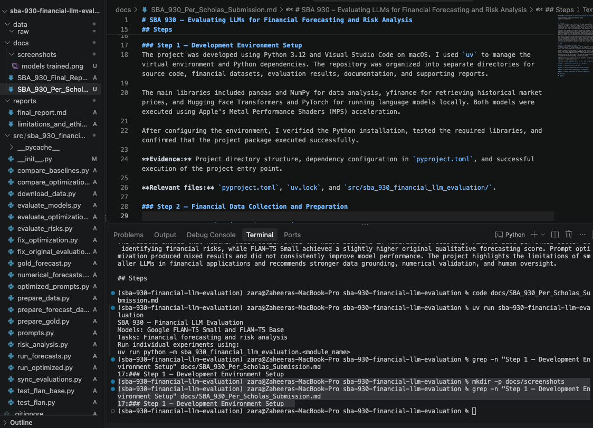
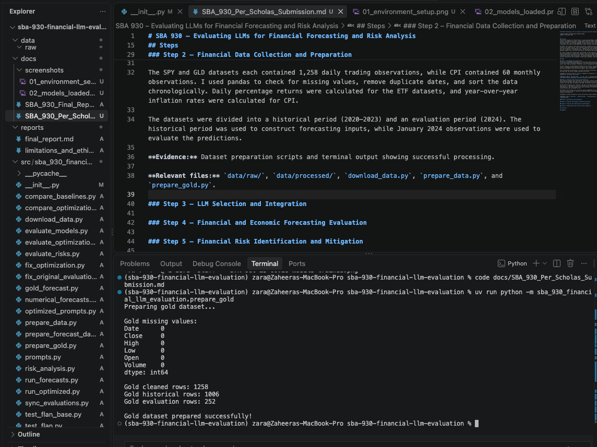
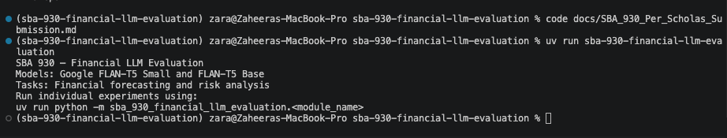
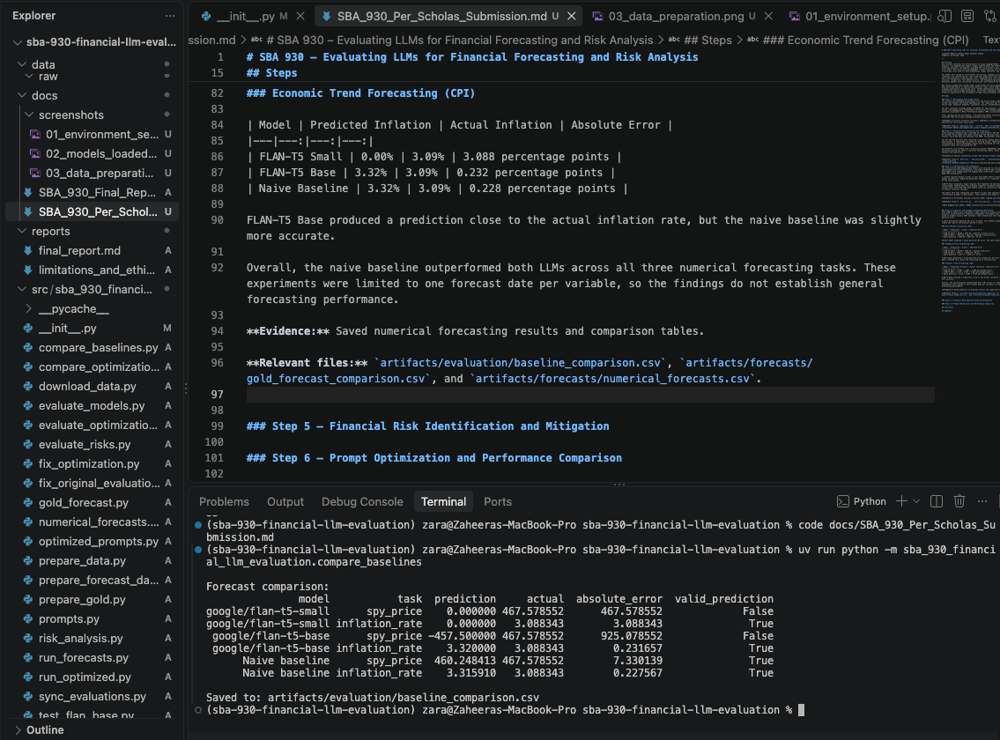
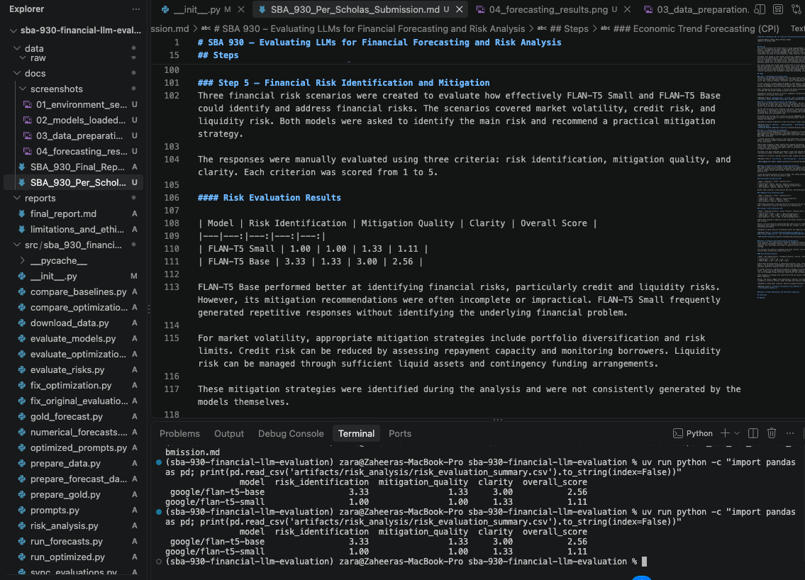
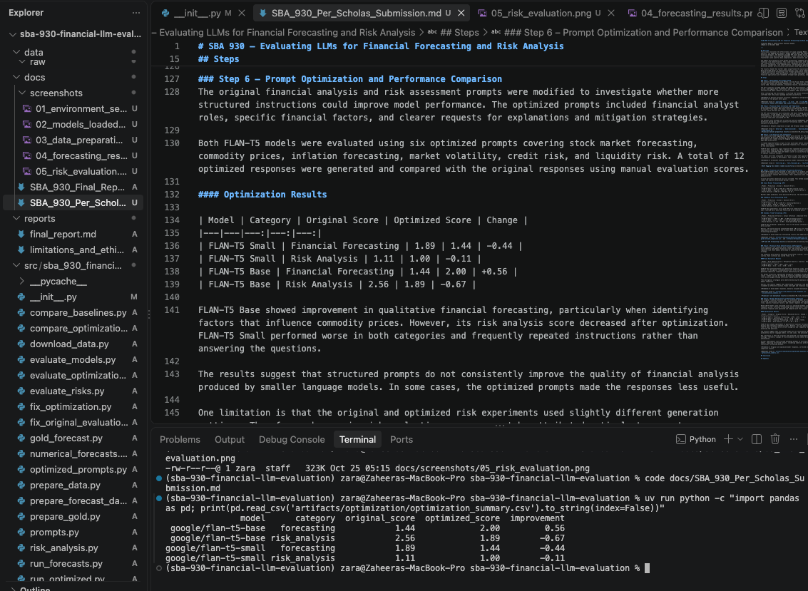

# SBA 930 – Evaluating LLMs for Financial Forecasting and Risk Analysis

**Learner Name:** Zaheera Bhanu Shanawaz Ahamed

**Date:** 25 October 2026

\newpage

## Overview

This project evaluates the effectiveness of Large Language Models (LLMs) in financial forecasting and risk analysis. Two Hugging Face models, Google FLAN-T5 Small and FLAN-T5 Base, were tested using historical financial datasets. The datasets included SPY stock market prices, GLD gold ETF prices, and US Consumer Price Index (CPI) data covering 2020–2024. Python libraries such as pandas, yfinance, PyTorch, and Transformers were used for data preparation, model execution, and evaluation.

The models were tested on stock market forecasting, commodity price trends, inflation prediction, and financial risk identification. Their numerical predictions were compared with actual January 2024 values and a naive baseline using absolute error. Responses were also evaluated for relevance, financial accuracy, reliability, risk identification, and mitigation quality. Prompt optimization was tested to determine whether more structured instructions could improve the models' performance.

The results showed that neither model outperformed the naive baseline in numerical forecasting. FLAN-T5 Base performed better at identifying financial risks, while FLAN-T5 Small achieved a slightly higher original qualitative forecasting score. Prompt optimization produced mixed results and did not consistently improve model performance. The project highlights the limitations of smaller LLMs in financial applications and recommends stronger data grounding, numerical validation, and human oversight.

## Steps

### Step 1 – Development Environment Setup
The project was developed using Python 3.12 and Visual Studio Code on macOS. I used `uv` to manage the virtual environment and Python dependencies. The repository was organized into separate directories for source code, financial datasets, evaluation results, documentation, and supporting reports.

The main libraries included pandas and NumPy for data analysis, yfinance for retrieving historical market prices, and Hugging Face Transformers and PyTorch for running language models locally. Both models were executed using Apple's Metal Performance Shaders (MPS) acceleration.

After configuring the environment, I verified the Python installation, tested the required libraries, and confirmed that the project package executed successfully.

**Evidence:** Project directory structure, dependency configuration in `pyproject.toml`, and successful execution of the project entry point.

**Relevant files:** `pyproject.toml`, `uv.lock`, and `src/sba_930_financial_llm_evaluation/`.

### Step 2 – Financial Data Collection and Preparation
Three financial datasets were collected for this project: SPY ETF stock prices, GLD ETF gold prices, and US Consumer Price Index (CPI) data. Historical SPY and GLD prices were downloaded using the yfinance library, while CPI data was obtained from FRED. The datasets covered January 2020 through December 2024.

The SPY and GLD datasets each contained 1,258 daily trading observations, while CPI contained 60 monthly observations. I used pandas to check for missing values, remove duplicate dates, and sort the data chronologically. Daily percentage returns were calculated for the ETF datasets, and year-over-year inflation rates were calculated for CPI.

The datasets were divided into a historical period (2020–2023) and an evaluation period (2024). The historical period was used to construct forecasting inputs, while January 2024 observations were used to evaluate the predictions.

**Evidence:** Dataset preparation scripts and terminal output showing successful processing.

**Relevant files:** `data/raw/`, `data/processed/`, `download_data.py`, `prepare_data.py`, and `prepare_gold.py`.

### Step 3 – LLM Selection and Integration
Two instruction-tuned Hugging Face models were selected for the evaluation: Google FLAN-T5 Small, with approximately 80 million parameters, and Google FLAN-T5 Base, with approximately 250 million parameters. Both models were loaded using the Hugging Face Transformers library and executed locally with PyTorch and Apple MPS acceleration.

I created separate Python scripts to test each model before running the evaluation experiments. Both models successfully loaded and generated responses to a financial question about inflation and its effect on the stock market.

FLAN-T5 Small produced a vague response that repeated the question without explaining the financial relationship. FLAN-T5 Base also provided a general statement without meaningful financial reasoning. These initial tests confirmed that both models could run successfully but revealed limitations in their ability to explain financial concepts.

The models were then integrated into Python scripts that applied the same financial forecasting and risk-analysis prompts to both models. Their outputs were saved as CSV files for further evaluation.

**Evidence:** Screenshot showing successful model loading and execution.

**Relevant files:** `test_flan.py`, `test_flan_base.py`, `run_forecasts.py`, and `risk_analysis.py`.

### Step 4 – Financial and Economic Forecasting Evaluation
Both FLAN-T5 models were evaluated on their ability to predict stock prices, commodity prices, and inflation using historical financial information. The models were provided with December 2023 values and asked to predict January 2024 outcomes. Their predictions were compared with actual historical data using absolute error.

A naive persistence baseline was also included. This method assumes that the next period's value will remain the same as the previous period's value.

### Stock Market Forecasting (SPY)

| Model | Prediction | Actual | Absolute Error |
|---|---:|---:|---:|
| FLAN-T5 Small | $0.00 | $467.58 | $467.58 (invalid price) |
| FLAN-T5 Base | -$457.50 | $467.58 | $925.08 (invalid price) |
| Naive Baseline | $460.25 | $467.58 | $7.33 |

Neither model produced a valid positive SPY price. The naive baseline performed substantially better.

### Commodity Price Forecasting (GLD)

| Model | Prediction | Actual | Absolute Error |
|---|---:|---:|---:|
| FLAN-T5 Small | $0.00 | $188.45 | Invalid prediction |
| FLAN-T5 Base | $179.17 | $188.45 | $9.28 |
| Naive Baseline | $191.17 | $188.45 | $2.72 |

FLAN-T5 Base generated a valid gold ETF price prediction but was less accurate than the baseline. FLAN-T5 Small returned zero, which was classified as an invalid price.

### Economic Trend Forecasting (CPI)

| Model | Predicted Inflation | Actual Inflation | Absolute Error |
|---|---:|---:|---:|
| FLAN-T5 Small | 0.00% | 3.09% | 3.088 percentage points |
| FLAN-T5 Base | 3.32% | 3.09% | 0.232 percentage points |
| Naive Baseline | 3.32% | 3.09% | 0.228 percentage points |

FLAN-T5 Base produced a prediction close to the actual inflation rate, but the naive baseline was slightly more accurate.

Overall, the naive baseline outperformed both LLMs across all three numerical forecasting tasks. These experiments were limited to one forecast date per variable, so the findings do not establish general forecasting performance.

**Evidence:** Saved numerical forecasting results and comparison tables.

**Relevant files:** `artifacts/evaluation/baseline_comparison.csv`, `artifacts/forecasts/gold_forecast_comparison.csv`, and `artifacts/forecasts/numerical_forecasts.csv`.

### Step 5 – Financial Risk Identification and Mitigation
Three financial risk scenarios were created to evaluate how effectively FLAN-T5 Small and FLAN-T5 Base could identify and address financial risks. The scenarios covered market volatility, credit risk, and liquidity risk. Both models were asked to identify the main risk and recommend a practical mitigation strategy.

The responses were manually evaluated using three criteria: risk identification, mitigation quality, and clarity. Each criterion was scored from 1 to 5.

#### Risk Evaluation Results

| Model | Risk Identification | Mitigation Quality | Clarity | Overall Score |
|---|---:|---:|---:|---:|
| FLAN-T5 Small | 1.00 | 1.00 | 1.33 | 1.11 |
| FLAN-T5 Base | 3.33 | 1.33 | 3.00 | 2.56 |

FLAN-T5 Base performed better at identifying financial risks, particularly credit and liquidity risks. However, its mitigation recommendations were often incomplete or impractical. FLAN-T5 Small frequently generated repetitive responses without identifying the underlying financial problem.

For market volatility, appropriate mitigation strategies include portfolio diversification and risk limits. Credit risk can be reduced by assessing repayment capacity and monitoring borrowers. Liquidity risk can be managed through sufficient liquid assets and contingency funding arrangements.

These mitigation strategies were identified during the analysis and were not consistently generated by the models themselves.

Overall, the results suggest that identifying a financial risk does not necessarily mean an LLM can recommend an effective solution. Human oversight and financial expertise remain important.

**Evidence:** Saved model responses, manually assigned evaluation scores, and risk evaluation summary.

**Relevant files:** `artifacts/risk_analysis/risk_responses.csv`, `risk_evaluation.csv`, and `risk_evaluation_summary.csv`.

### Step 6 – Prompt Optimization and Performance Comparison
The original financial analysis and risk assessment prompts were modified to investigate whether more structured instructions could improve model performance. The optimized prompts included financial analyst roles, specific financial factors, and clearer requests for explanations and mitigation strategies.

Both FLAN-T5 models were evaluated using six optimized prompts covering stock market forecasting, commodity prices, inflation forecasting, market volatility, credit risk, and liquidity risk. A total of 12 optimized responses were generated and compared with the original responses using manual evaluation scores.

#### Optimization Results

| Model | Category | Original Score | Optimized Score | Change |
|---|---|---:|---:|---:|
| FLAN-T5 Small | Financial Forecasting | 1.89 | 1.44 | -0.44 |
| FLAN-T5 Small | Risk Analysis | 1.11 | 1.00 | -0.11 |
| FLAN-T5 Base | Financial Forecasting | 1.44 | 2.00 | +0.56 |
| FLAN-T5 Base | Risk Analysis | 2.56 | 1.89 | -0.67 |

FLAN-T5 Base showed improvement in qualitative financial forecasting, particularly when identifying factors that influence commodity prices. However, its risk analysis score decreased after optimization. FLAN-T5 Small performed worse in both categories and frequently repeated instructions rather than answering the questions.

The results suggest that structured prompts do not consistently improve the quality of financial analysis produced by smaller language models. In some cases, the optimized prompts made the responses less useful.

One limitation is that the original and optimized risk experiments used slightly different generation settings. Therefore, changes in risk evaluation scores cannot be attributed entirely to prompt optimization.

Further improvements could include grounding prompts in verified financial data, using domain-specific models, requiring structured outputs, validating numerical predictions, and combining LLMs with statistical forecasting methods.

**Evidence:** Original and optimized model responses, corrected evaluation scores, and optimization comparison results.

**Relevant files:** `artifacts/optimization/optimized_responses.csv`, `optimization_evaluated.csv`, and `optimization_summary.csv`.

## Conclusion

This project helped me understand how smaller language models perform when applied to financial forecasting and risk analysis. I evaluated Google FLAN-T5 Small and FLAN-T5 Base using historical stock market, gold ETF, and inflation data. The experiments showed that neither model outperformed a simple historical baseline in numerical forecasting. Both models also struggled with detailed financial reasoning and producing reliable predictions.

FLAN-T5 Base performed better at identifying financial risks, especially credit and liquidity risks, but its mitigation strategies were often incomplete. Prompt optimization improved some forecasting responses but did not consistently improve overall performance. In several cases, more detailed prompts actually produced worse responses.

The main takeaway is that generating a financial prediction does not mean the prediction is accurate or useful. LLMs need to be evaluated against real historical outcomes and reliable baselines. Their outputs should also be checked for incorrect information, unrealistic predictions, and unsupported recommendations.

The project also highlighted ethical concerns such as financial misinformation, bias, data privacy, and accountability. In future work, I would test larger or finance-specific models, evaluate predictions across more historical periods, and combine LLMs with statistical forecasting methods. Overall, this assessment demonstrated the importance of data validation, systematic evaluation, and human oversight when using AI for financial decision-making.

## Appendix

### A. Financial Datasets

The project used three financial datasets covering January 2020 through December 2024.

| Dataset | Source | Records | Purpose |
|---|---|---:|---|
| SPY ETF | Yahoo Finance via yfinance | 1,258 | Stock market forecasting |
| GLD ETF | Yahoo Finance via yfinance | 1,258 | Commodity price forecasting |
| US CPI | Federal Reserve Economic Data (FRED) | 60 | Inflation forecasting |

Dataset sources:
- SPY: https://finance.yahoo.com/quote/SPY/history/
- GLD: https://finance.yahoo.com/quote/GLD/history/
- CPI: https://fred.stlouisfed.org/series/CPIAUCSL

The original datasets are stored in `data/raw/`, while cleaned and split datasets are stored in `data/processed/`.

### B. Models and Implementation

The following Hugging Face models were evaluated:

- Google FLAN-T5 Small: https://huggingface.co/google/flan-t5-small
- Google FLAN-T5 Base: https://huggingface.co/google/flan-t5-base

Both models were executed locally using Python, PyTorch, and Hugging Face Transformers.

The source code is available in `src/sba_930_financial_llm_evaluation/`.

### C. Evaluation Artifacts

The following files contain the results of the experiments:

| File | Description |
|---|---|
| `artifacts/evaluation/baseline_comparison.csv` | Stock and inflation forecasting comparisons |
| `artifacts/forecasts/gold_forecast_comparison.csv` | Gold ETF forecasting results |
| `artifacts/evaluation/model_evaluation.csv` | Original qualitative response scores |
| `artifacts/risk_analysis/risk_evaluation.csv` | Risk identification and mitigation scores |
| `artifacts/optimization/optimization_evaluated.csv` | Evaluated optimized responses |
| `artifacts/optimization/optimization_summary.csv` | Original versus optimized performance summary |

### D. Screenshots and Evidence

The following screenshots document the project execution and evaluation results.

**Figure 1. Development environment setup**

**Figure 2. Hugging Face model loading**

**Figure 3. Financial data preparation**

**Figure 4. Numerical forecasting comparison**

**Figure 5. Financial risk evaluation**

**Figure 6. Prompt optimization results**

### E. Limitations and Future Work

The experiments used one historical forecasting date per financial variable, limiting the generalizability of the results. The evaluation also compared two models from the same FLAN-T5 family rather than different model architectures.

Future work could include testing larger or finance-specific language models, conducting forecasts across multiple historical periods, using real-time economic information, and implementing more robust numerical validation.

The complete detailed analysis is available in `docs/SBA_930_Final_Report.md`.
